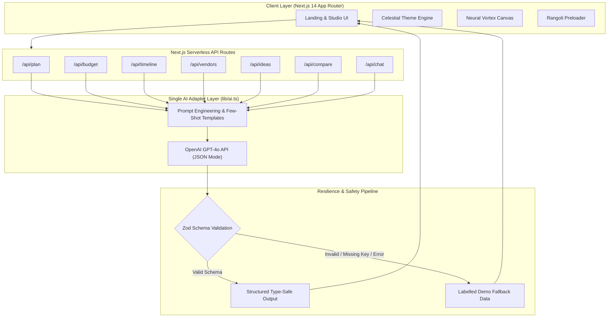

<div align="center">

# 🎉 FESTIVA

### *Intelligent, GenAI-Powered Event Planning Studio for Weddings, Birthdays & Festivals*

[](https://nextjs.org/)
[](https://www.typescriptlang.org/)
[](https://platform.openai.com/)
[](https://tailwindcss.com/)
[](https://gsap.com/)
[](https://zod.dev/)
[](LICENSE)
[](https://github.com/jogadiyadipak28-art/FESTIVE)

<br/>

> **"Plans that hold a crowd."**  
> Festiva is an event orchestration platform combining Generative AI with structured runtime validation to deliver end-to-end event plans, itemized budgets, vendor playbooks, day-of schedules, and creative concepts.

<br/>

[✨ Features](#-features) • [🏗️ Architecture](#-architecture-diagram) • [🚀 Quick Start](#-getting-started) • [📡 API Reference](#-api-endpoints) • [🛡️ Zero-Crash Resilience](#-resilience--zero-crash-philosophy) • [🛠️ Tech Stack](#-tech-stack)

</div>

---

## 🌟 Highlights

- 🧠 **Multi-Modal Event Intelligence**: Generate end-to-end plans across weddings, milestone birthdays, and community festivals.
- 📐 **Strict Schema Guarantees**: 100% of LLM outputs pass through strict [Zod](https://zod.dev/) schema parsers before rendering.
- 🛡️ **Zero-Crash Resilience**: Automatic fallback to rich demo data if API keys are omitted or OpenAI encounters rate limits.
- 🎨 **Kinetic Cultural UI**: Interactive Rangoli loading animation, WebGL Neural Vortex backdrop, physics-based card fan gallery, and celestial sun-moon theme switcher.
- ⚖️ **Side-by-Side Plan Comparison**: Head-to-head evaluation of two contrasting event packages across budget, pacing, and vendor density.
- 💬 **Context-Aware AI Co-Pilot**: Conversational event consultant capable of answering follow-ups and tailoring recommendations on the fly.

---

## ✨ Features

| Feature | Description | Status |
|:---|:---|:---:|
| 📋 **Full Event Architect** | Generates an executive overview, thematic motifs, vendor timeline, and contingency plans | ✅ Live |
| 💰 **Dynamic Budget Breakdown** | Itemizes expenditures by category (venue, catering, decor, entertainment) with target % and savings tips | ✅ Live |
| 📅 **Dual-Mode Timelines** | Minute-by-minute day-of itinerary and multi-week countdown schedule | ✅ Live |
| 🏪 **Vendor Management Matrix** | Structured checklist with priorities, estimated allocations, and negotiation questions | ✅ Live |
| 💡 **Creative Innovation Engine** | Curates signature drinks, interactive entertainment, floral concepts, and personalized favors | ✅ Live |
| ⚖️ **Plan Comparison Mode** | Evaluates Plan A vs Plan B across cost-efficiency, guest experience, and logistical complexity | ✅ Live |
| 💬 **Event Planner Chatbot** | Conversational co-pilot providing contextual advice and real-time adjustments | ✅ Live |
| 🎨 **Rangoli Preloader** | Mathematically generated geometric rangoli loading screen with smooth transitions | ✅ Live |
| 🌓 **Celestial Theme Switcher** | Animated sun-moon toggle with star twinkling, orbital paths, and CSS variable morphing | ✅ Live |
| 🃏 **Physics Card Fan Carousel** | Interactive, draggable card fan showcasing event categories with spring physics | ✅ Live |
| 🌌 **Neural Vortex Canvas** | Interactive particle background providing a dynamic visual atmosphere | ✅ Live |

---

## 🏗️ Architecture Diagram

Festiva uses a **Single AI Adapter Architecture** ensuring all requests follow an identical validation pipeline:



---

## 🛡️ Resilience & Zero-Crash Philosophy

Festiva is built with a resilient safety net:

1. **Structured Outputs**: Live calls prompt OpenAI to reply strictly in valid JSON adhering to our TypeScript types.
2. **Runtime Zod Validation**: Every payload is verified by Zod before reaching React component state.
3. **Graceful Demo Fallback**: If an OpenAI API key is missing, network errors occur, or rate limits are reached, the app automatically serves labelled demo datasets.
4. **No Silent Fakes**: When fallback data is active, the UI clearly displays demo indicators so judges and users know the data source.

---

## 📁 Repository Structure

```
festiva/
├── src/
│   ├── app/
│   │   ├── api/                     # Serverless API endpoints
│   │   │   ├── budget/route.ts      # POST: Budget breakdown generator
│   │   │   ├── chat/route.ts        # POST: Conversational AI co-pilot
│   │   │   ├── compare/route.ts     # POST: Plan comparison engine
│   │   │   ├── ideas/route.ts       # POST: Creative ideas generator
│   │   │   ├── plan/route.ts        # POST: Full event plan generator
│   │   │   ├── timeline/route.ts    # POST: Day-of & countdown timelines
│   │   │   └── vendors/route.ts     # POST: Vendor matrix & questions
│   │   ├── architecture/            # Architecture showcase page
│   │   ├── planner/                 # Interactive Studio workspace
│   │   ├── globals.css              # Theme tokens & custom animations
│   │   ├── layout.tsx               # Root layout & font optimization
│   │   └── page.tsx                 # Landing page with hero & gallery
│   ├── components/
│   │   ├── FestivaHero.tsx          # Dynamic hero with fluid animations
│   │   ├── Studio.tsx               # Main planner workspace & tab views
│   │   └── ui/                      # Reusable, accessible UI primitives
│   │       ├── card-fan-carousel.tsx       # Physics-based card fan
│   │       ├── interactive-neural-vortex-background.tsx # Canvas particle vortex
│   │       ├── rangoli-preloader.tsx       # Animated cultural preloader
│   │       ├── sun-moon-theme-toggle.tsx   # Celestial theme switcher
│   │       └── ...                  # Button, Card, Dialog, Tabs, Select
│   └── lib/
│       ├── ai.ts                    # Single OpenAI adapter
│       ├── api-handler.ts           # Standardized API response wrappers
│       ├── demo.ts                  # Pre-validated fallback datasets
│       ├── prompts.ts               # Engineered prompts for each event type
│       ├── schemas.ts               # Zod validation schemas
│       ├── types.ts                 # TypeScript interfaces
│       ├── utils.ts                 # Classname and styling helpers
│       └── validate.ts              # Safe parsing & schema verification
├── .env.example                     # Environment template
├── .gitignore                       # Clean Git configuration
├── LICENSE                          # MIT License
├── next.config.mjs                  # Next.js configuration
├── package.json                     # Dependencies & scripts
├── tailwind.config.ts               # Tailwind design tokens
└── tsconfig.json                    # TypeScript compiler configuration
```

---

## 🚀 Getting Started

### Prerequisites

- **Node.js**: `v18.17.0` or higher
- **npm** or **yarn** or **pnpm**
- **OpenAI API Key** *(optional, falls back to demo mode if not provided)*

### 1. Clone the Repository

```bash
git clone https://github.com/jogadiyadipak28-art/FESTIVE.git
cd FESTIVE
```

### 2. Install Dependencies

```bash
npm install
```

### 3. Configure Environment Variables

Copy the example environment file:

```bash
cp .env.example .env.local
```

Add a Groq API key to `.env.local` to power the AI planner:

```env
GROQ_API_KEY=your_groq_api_key
GROQ_MODEL=qwen/qwen3.8-27b
```

Groq's OpenAI-compatible API powers Festiva's planning responses. Gemini (`GEMINI_API_KEY`), OpenRouter (`OPENROUTER_API_KEY`), and OpenAI (`OPENAI_API_KEY`) are also supported as alternatives.

> **Note**: Even without an API key, Festiva works out-of-the-box using the built-in demo dataset!

### 4. Run Development Server

```bash
npm run dev
```

Visit [http://localhost:3000](http://localhost:3000) in your browser.

### 5. Build for Production

```bash
npm run build
npm start
```

---

## 📡 API Endpoints

All endpoints accept `POST` requests with a JSON body and return verified structured data:

| Endpoint | Method | Key Parameters | Output |
|:---|:---:|:---|:---|
| `/api/plan` | `POST` | `eventType`, `guestCount`, `budget`, `location`, `vibe` | Complete structured plan with executive summary, budget, timeline, vendors |
| `/api/budget` | `POST` | `eventType`, `totalBudget`, `guestCount`, `priorities` | Category breakdown, percentage shares, line items, money-saving tips |
| `/api/timeline` | `POST` | `eventType`, `eventDate`, `durationHours` | Minute-by-minute day-of schedule and multi-week preparation countdown |
| `/api/vendors` | `POST` | `eventType`, `location`, `budget` | Vendor categories, recommended budget allocations, status, and questions to ask |
| `/api/ideas` | `POST` | `eventType`, `theme`, `preferences` | Curated concepts for themes, decor, food & drinks, activities, favors |
| `/api/compare` | `POST` | `planA`, `planB` | Comprehensive comparative breakdown, pros/cons, and final recommendation |
| `/api/chat` | `POST` | `messages`, `eventContext` | Conversational response tailored to the active event state |

---

## 🎪 Event Types Supported

Festiva provides deep domain models for different event categories:

| Event Type | Typical Guest Range | Key Customizations |
|:---|:---:|:---|
| 💍 **Weddings** | 50 – 500+ | Sangeet, Mehendi, Ceremony, Reception, Seating charts, Photography shot lists, Floral installations |
| 🎂 **Milestone Birthdays** | 10 – 150 | Themed decor, Signature cakes, Live DJ/Music, Memory lanes, Speeches, Party favors |
| 🪔 **Community Festivals** | 100 – 2000+ | Cultural ceremonies, Stage management, Crowd control, Food stalls, Vendor coordination |

---

## 🛠️ Tech Stack

<div align="center">

| Area | Technologies |
|:---|:---|
| **Framework** | Next.js 14 (App Router, Serverless Functions) |
| **Language** | TypeScript 5 (Strict Mode) |
| **Artificial Intelligence** | OpenAI GPT-4o with structured JSON mode |
| **Schema Validation** | Zod 3.x |
| **Styling** | Tailwind CSS 3.4, Custom CSS Variables |
| **Animation & Graphics** | GSAP 3.15, HTML5 Canvas API, SVG Animations |
| **UI Primitives** | Radix UI (Dialog, Select, Tabs, Separator, Progress) |
| **Icons** | Lucide React |
| **Code Quality** | ESLint, TypeScript Strict Checking |

</div>

---

## 🤝 Contributing

Contributions are welcome! Please follow these steps:

1. Fork the Project
2. Create your Feature Branch (`git checkout -b feature/AmazingFeature`)
3. Commit your Changes (`git commit -m 'Add some AmazingFeature'`)
4. Push to the Branch (`git push origin feature/AmazingFeature`)
5. Open a Pull Request

---

## 📄 License

This project is licensed under the MIT License — see the [LICENSE](LICENSE) file for details.

---

<div align="center">

Crafted with ❤️ for **PromptWars 5**  
*Empowering memorable celebrations with the magic of Generative AI.*

</div>
